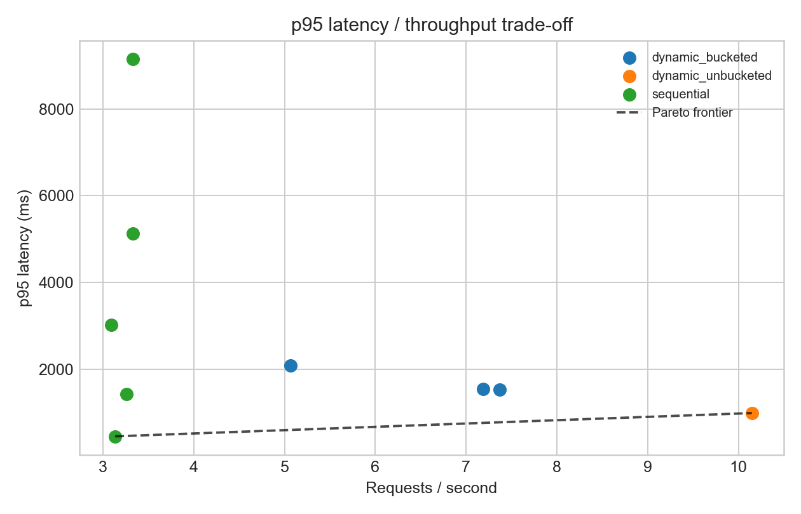
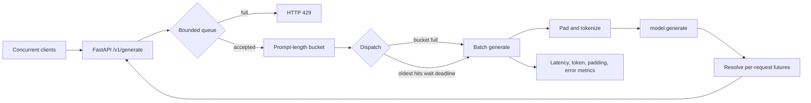
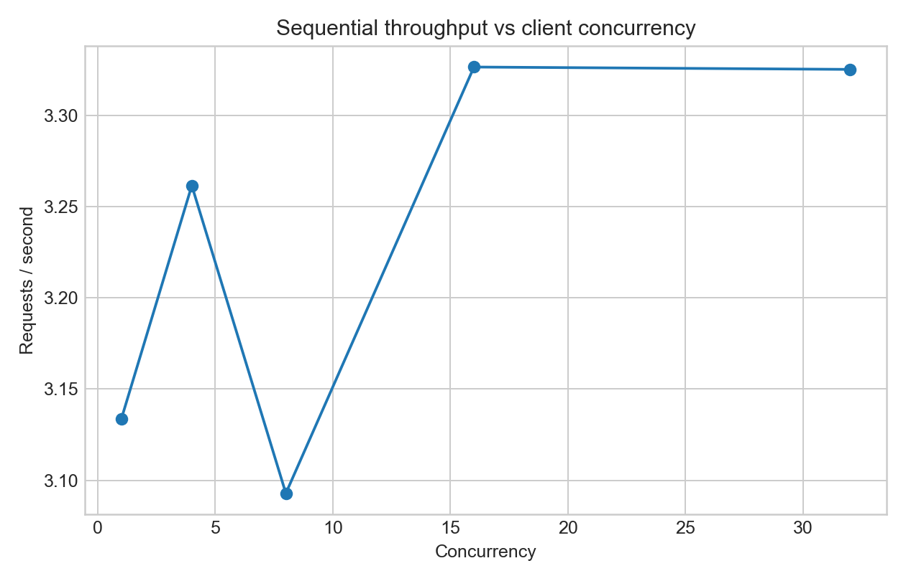
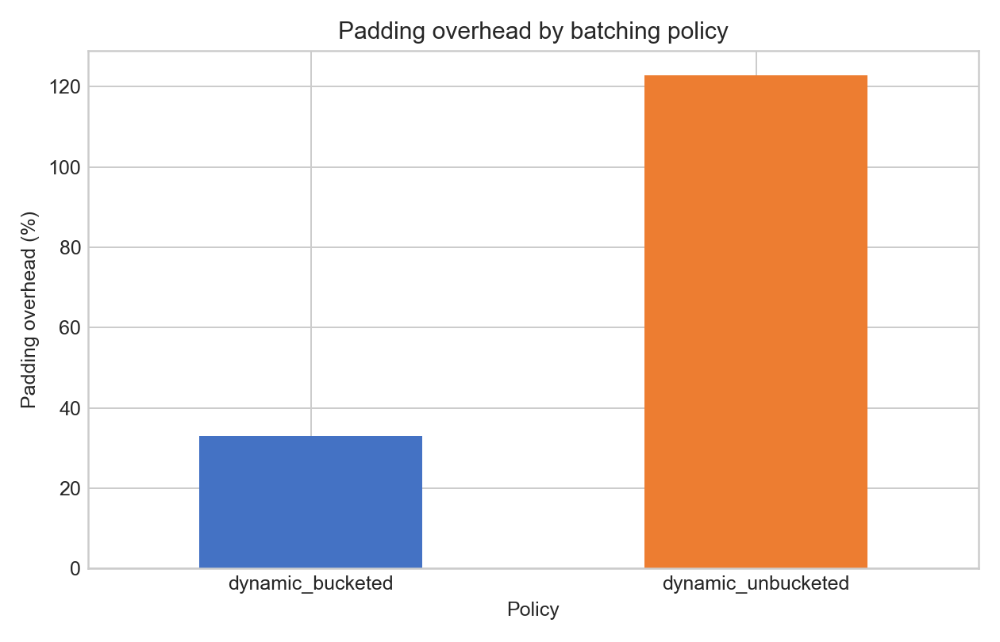

# Dynamic-Batching LLM Inference Scheduler

An inference gateway that accepts concurrent generation requests, applies bounded
backpressure, and compares a sequential baseline with deadline-driven dynamic batching.
This is a small inference-systems experiment: one model, one device, one API, and measured
throughput/tail-latency trade-offs.

On an Apple M3, the best measured throughput policy delivered **10.15 requests/s** and
**81.18 generated tokens/s** at concurrency 8—**3.28× the sequential throughput** at the
same concurrency—while reducing p95 latency from **3,023 ms to 984 ms**. Both policies
used the same model, interleaved corpus, deterministic greedy decoding, and exactly eight
new tokens per request.



## Why this project exists

Sequential inference wastes an opportunity: several waiting prompts can share one model
forward pass. Unbounded batching is not a solution, because waiting for a large batch can
destroy interactive latency and an unlimited queue fails unpredictably under overload.

This gateway makes three scheduling constraints explicit:

- `max_batch_size` caps work and memory per dispatch.
- `max_wait_ms` dispatches a partial batch when its oldest request reaches a deadline.
- `max_queue_size` rejects excess work with HTTP 429 instead of silently accumulating it.

V1 and V2 expose the same `POST /v1/generate` contract. V1 always sends one prompt to the
backend. V2 maintains prompt-length buckets and fulfills each caller's own future after a
batch returns. A request timeout yields HTTP 504; backend failures yield HTTP 503.

## Architecture and scheduling policy



The text source is also in [`docs/architecture.mmd`](docs/architecture.mmd). Bucket
boundaries `(32, 128, 512)` mean that a 20-token and a 90-token prompt wait in different
queues. The worker chooses a full bucket first; otherwise it dispatches the bucket holding
the globally oldest request when its deadline expires. V1 selects the globally oldest
request and always dispatches exactly one.

Cancellation removes a request if it is still queued. If model work has already started,
the batch finishes but the cancelled future is never fulfilled. The scheduler validates
that a backend returns exactly one result per batch item, preserves list order, and records
metrics only when a live request receives a result. Tokenizer calls are protected by a
short lock because the fast tokenizer is not safe for concurrent admission estimation and
worker tokenization; model execution itself is not held under that lock.

## Reproduce locally

Prerequisites: `uv` and macOS/Linux. The lockfile selects Python 3.11 and pins every direct
and transitive dependency.

```bash
# After cloning the repository:
cd dynamic-batching-llm-scheduler
make setup
make verify
make serve
```

The first real-model launch downloads
[`HuggingFaceTB/SmolLM2-135M-Instruct`](https://huggingface.co/HuggingFaceTB/SmolLM2-135M-Instruct),
a 135M-parameter Apache-2.0 model. Device selection prefers CUDA, then Apple MPS, then CPU.
For a real CPU smoke test:

```bash
.venv/bin/llm-scheduler --device cpu --max-new-tokens 4 --max-batch-size 2
```

Send a request from another terminal:

```bash
curl -s http://127.0.0.1:8000/v1/generate \
  -H 'content-type: application/json' \
  -H 'x-request-id: demo-1' \
  -d '{"prompt":"Explain dynamic batching in one sentence."}' | python -m json.tool
```

Switch modes and exercise load:

```bash
make serve-v1                         # sequential baseline
make serve                            # dynamic defaults
make load                             # 40 requests at concurrency 8
```

The fake backend exists only for fast scheduler tests and must not be used for model
performance claims:

```bash
.venv/bin/llm-scheduler --backend fake --max-wait-ms 5
```

## Configuration

All server settings are CLI flags; the underlying settings also accept uppercase
environment variables such as `MODEL_ID` or `MAX_BATCH_SIZE`.

| Concern | CLI flag | Default |
|---|---|---:|
| Scheduler | `--mode {sequential,dynamic}` | `dynamic` |
| Backend/model | `--backend`, `--model` | `transformers`, SmolLM2-135M-Instruct |
| Compute | `--device`, `--dtype` | `auto`, `auto` |
| Batch bounds | `--max-batch-size`, `--max-wait-ms` | `4`, `10` |
| Backpressure | `--max-queue-size`, `--request-timeout-s` | `128`, `30` |
| Length policy | `--length-buckets` | `32,128,512` |
| Input/output | `--max-input-tokens`, `--min-new-tokens`, `--max-new-tokens` | `512`, `0`, `16` |
| Generation | `--temperature`, `--seed` | `0`, `7` |

## Benchmark methodology

The checked-in corpus has four short, four medium, and four long prompts in deterministic,
interleaved order. The async load generator uses closed-loop concurrency: each client sends
its next corpus item when the prior one completes. It validates the returned request ID and
stores per-request service and client timings.

The measured run used:

- 32 measured requests per configuration, 2 warm-ups, and 2 trials;
- V1 at concurrency `1, 4, 8, 16, 32`;
- V2 representative policies `(batch, wait) = (2,2 ms), (4,5 ms), (8,10 ms)` at concurrency 8;
- a matched unbucketed `(4,5 ms)` run to isolate length bucketing;
- SmolLM2-135M-Instruct, MPS, greedy decoding, seed 7, exactly 8 new tokens;
- a fresh server process per configuration, with startup/model load excluded from metrics.

The full requested sweep is preserved but was not executed because it expands the real-model
run from 18 to 52 isolated server/trial runs without improving the representative portfolio
comparison:

```bash
make benchmark-full   # batch {1,2,4,8} × wait {0,2,5,10,20}, plus V1 levels
make plots
```

The harness records OS, Python, memory, accelerator availability, model, generation config,
and dependency versions in each raw JSON file. p50/p95/p99 use end-to-end service latency
from queue admission through generation completion. Padding overhead is
`(padded prompt tokens - useful prompt tokens) / useful prompt tokens`. TTFT is deliberately
absent because this API does not stream; it is not approximated.

## Measured results

Hardware: Apple M3 MacBook Air, 10-core integrated GPU, 16 GiB unified memory, macOS 26.6.2.
Software: Python 3.11.14, PyTorch 2.7.1, Transformers 4.53.2, FastAPI 0.116.1. Values below
are means across two trials; all 576 measured requests succeeded.

| Policy | Concurrency | Batch / wait | req/s | generated tok/s | p50 ms | p95 ms | p99 ms | mean queue ms | padding overhead |
|---|---:|---:|---:|---:|---:|---:|---:|---:|---:|
| V1 sequential | 1 | 1 / 0 ms | 3.13 | 25.07 | 287 | 447 | 473 | 0 | 0% |
| V1 sequential | 8 | 1 / 0 ms | 3.09 | 24.74 | 2,440 | 3,023 | 3,058 | 1,983 | 0% |
| V1 sequential | 32 | 1 / 0 ms | 3.33 | 26.60 | 5,260 | 9,143 | 9,493 | 4,808 | 0% |
| V2 bucketed | 8 | 2 / 2 ms | 5.06 | 40.50 | 1,399 | 2,087 | 2,360 | 1,041 | 25% |
| V2 bucketed | 8 | 4 / 5 ms | 7.37 | 58.97 | 987 | 1,532 | 1,566 | 572 | 33% |
| V2 bucketed | 8 | 8 / 10 ms | 7.19 | 57.50 | 1,048 | 1,540 | 1,592 | 578 | 33% |
| V2 unbucketed | 8 | 4 / 5 ms | **10.15** | **81.18** | **694** | **984** | **985** | **352** | 123% |





At concurrency 8, unbucketed V2 was **3.28× faster** in requests/s than V1 and cut p95
latency by **67.4%**. Queue time explains most of the change: V1 waited 1,983 ms on average,
versus 352 ms for batched V2. The measured Pareto frontier contains V1 at concurrency 1
(lowest latency) and unbucketed V2 at concurrency 8 (highest throughput among tested points).

Length-aware batching did what it was designed to do: at the matched batch-4/wait-5 setting,
it reduced padding overhead from 123% to 33%, a **73.2% relative reduction**. It was still
slower on this workload and device: throughput fell 27.4% and p95 rose 55.7% compared with
unbucketed V2. Splitting eight active clients across buckets prevented batches from filling
quickly enough; saved prompt-prefill padding did not repay that fragmentation cost.

Raw records and full metadata are in
[`artifacts/raw/benchmark-m3-real.json`](artifacts/raw/benchmark-m3-real.json). The generated
full table and computed Pareto set are in
[`artifacts/plots/RESULTS.md`](artifacts/plots/RESULTS.md). The fake-backend artifact is
explicitly labeled `scheduler-only-fake` and is not used above.

## What I learned

The best policy depends on the joint arrival and length distribution, not only model size.
Length bucketing wins its local objective—less padding—but may lose the user-facing objective
when arrival rate is too low to fill multiple queues. With higher concurrency, a wider prompt
distribution, longer prefill, or a prefill-bound accelerator, that 73% padding reduction may
matter more than the added wait. Here, small-model decoding and bucket fragmentation dominated,
so the simpler unbucketed batch was the measured throughput/latency winner.

The batch-size-8 policy also failed to beat batch size 4. A larger cap is merely permission to
wait for more work; it does not guarantee better device efficiency. Tail latency and padding
must be measured together, then a policy should be chosen from the workload's Pareto frontier.

## Reliability and tests

`make verify` runs formatting, Ruff, 15 unit/API tests, and one end-to-end test that starts a
real Uvicorn process and sends 12 concurrent, correlated requests. Coverage targets:

- full-batch and wait-deadline dispatch;
- prompt-length bucket selection and isolation;
- request/response correlation across 24 concurrent submissions;
- queued cancellation, end-to-end timeout, and bounded overload rejection;
- sequential batch-size-one behavior and metric calculations;
- useful generated-token accounting around EOS padding;
- live HTTP health, generation, metrics, and concurrent batching.

The same locked verification runs on Ubuntu for every push to `main` and every pull request
through [GitHub Actions](.github/workflows/ci.yml). Dependabot checks Python and workflow
dependencies monthly.

## Limitations

- This is request-level continuous batching: new requests join between `generate` calls, not
  at every decode iteration as in production engines such as vLLM.
- Results cover one 135M model, one MPS device, a 12-prompt closed-loop corpus, and two trials;
  they should not be generalized to large CUDA models or open-loop production arrivals.
- The representative V2 subset is measured; the full 20-point batch/wait grid is runnable but
  not claimed.
- There is no streaming, TTFT, KV-cache paging, distributed execution, or custom kernel work.
- The in-process metric registry is intentionally simple and resets when the server restarts.

## Repository map

```text
src/llm_scheduler/    API, scheduler, model backend, load generator, benchmark, plots
tests/                unit, API, and live-server end-to-end tests
data/prompts.jsonl    deterministic mixed-length workload
artifacts/raw/        raw per-request benchmark JSON and metadata
artifacts/plots/      figures, aggregate CSV, results table, Pareto frontier
docs/architecture.mmd text-source architecture diagram
DEMO.md               2–3 minute demo script
RESUME.md             measured resume-bullet options
```

## License

Project code is MIT licensed. The configured model has its own license on its model card.
